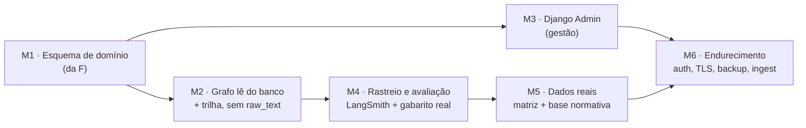

# ADR-0002: LangGraph, LangSmith e Django Admin como framework do motor, do rastreio e da gestão

- **Status:** Aceita — decisão G2 tomada em 2026-11-16. O documento entra por **PR sem merge**; o merge é do responsável pelo produto.
- **Data:** 2026-11-16
- **Bead:** leia-lab-1g1.7 (épico leia-lab-1g1); gate humano leia-lab-1g1.6.
- **Continua:** ADR-0001 (decisões de produto antes do motor e da gestão). Não substitui nenhuma ADR.

## Contexto

A ADR-0001 deixou o motor e a ferramenta de gestão em aberto (Q5) e definiu o processo para fechar a escolha: pesquisa com fontes (B2), protótipos descartáveis sobre uma base comum (F) feitos por camada — rastreio (B3) e gestão (B4) —, gate humano (G1, G2) e esta ADR.

O que existia antes da avaliação:

1. `master`: grafos **LangGraph** (ingestão, consulta e análise de minuta), validação determinística, criticidade vinda da matriz, mascaramento obrigatório em `src/ingest/masking.py`. Sem interface de gestão nem de uso.
2. Branch `buhlerr/resume-previous-work-session` ("acornworm"): pipeline **pydantic-ai** com Streamlit, gestão de tipos e prompts no banco, ~107 testes — **sem mascaramento** de dados pessoais.

O que a avaliação produziu (fontes primárias nas beads e em `docs/research/2026-11-framework-evaluation.md`):

- **F** (`1g1.9`, branch `prototype/foundation`): tabelas de domínio, histórico *append-only* por gatilho, `analyses` com **snapshot das regras** (JSON + hash), `analysis_trail`, gabarito de 10 cláusulas, e o grafo lendo regras do banco e **sem `raw_text` no estado**.
- **B3** (`1g1.4`, branch `prototype/tracing`): LangSmith, Langfuse Cloud e Phoenix self-hosted ligados no **mesmo grafo**, sem tocar o grafo (`analyze(graph, config=...)`), com prova empírica de que nenhum texto cru sai do processo e margem gratuita medida por análise.
- **B4** (`1g1.5`, branch `prototype/management`): Django Admin e Directus sobre **as mesmas tabelas**, com `db_user` distinto no histórico (`django_login` × `directus_login`), DELETE do histórico negado nos dois, e o teste manual do usuário — que editou R-04 e o prompt `triagem_risco` **sem ajuda** no Django e travou no Directus (a tela abria vazia e o campo de tema pedia um id digitado).

O G2 foi decidido em 2026-11-16, com os números da B3/B4 à vista.

## Decisão

| Camada | Escolha | Como entra no produto |
|---|---|---|
| **Motor** | **LangGraph do `master`** (`src/graphs/`) | Sem reescrita. A única mudança é a que a F já provou: o grafo passa a ler tipos, temas, matriz e prompts **do banco** em vez de `DEFAULT_*` |
| **Rastreio** | **LangSmith** (plano Developer, SaaS, região US) | Só variáveis de ambiente (`LANGSMITH_TRACING`, `LANGSMITH_API_KEY`, `LANGSMITH_PROJECT`). Nenhum código de produção |
| **Gestão** | **Django Admin** (`src/management/`) sobre as tabelas de domínio | App Django no próprio repositório, com login **próprio** no Postgres (membro de `leia_app`), para o histórico distinguir quem escreveu |
| **Trilha auditável** | **Postgres próprio** — histórico *append-only* + snapshot por análise | Requisito duro do Q8. A ferramenta de rastreio é a vista de depuração, **não** a fonte da auditoria |

**Ficam de fora:** Langfuse (Cloud e self-host), Directus, pydantic-ai como produto, Logfire, Langflow. O **Phoenix self-hosted** não é rastreio de produção; continua como instrumento local de medição e depuração no CT 116, sem compromisso de disponibilidade.

**O que a escolha não muda:**

- A **criticidade** continua vindo da matriz, nunca do LLM; a validação continua determinística.
- O **mascaramento** continua obrigatório antes de toda chamada externa — e traço enviado a SaaS conta como chamada externa.
- Os **prompts continuam sendo dado** na tabela `prompts`, editados no Django Admin. O Prompt Hub da LangSmith **não** é usado como fonte de verdade; seria uma segunda fonte de prompts sem histórico no Postgres.

## Evidências que sustentaram a decisão

| Critério (Q8) | Evidência medida | Origem |
|---|---|---|
| Menor reescrita do motor (3º desempate) | `analyze()` já aceitava `config`; as 3 ferramentas de rastreio entraram **sem alterar o grafo** | B3, `TRACING.md` |
| Menor reescrita de gestão | Django: `inspectdb`-like + `ModelAdmin`; `ForeignKey` vira seletor e `choices` vira dropdown **sem configuração de UI** | B4 |
| Margem do grátis | **1 traço por análise** (9 runs enviados, 1 raiz) · 5.000 traços/mês ⇒ **~5.000 análises/mês** | B3, `measure_langsmith_runs.py` |
| Margem do concorrente | Langfuse conta traço **+ cada observação**: ~108 unidades/análise ⇒ **~460 análises/mês** no Hobby (50k) | B3 |
| Admin usável por não desenvolvedor (1º desempate) | **testado pelo usuário**: mudou R-04 (amarelo→vermelho) e editou o prompt `triagem_risco` sem ajuda; histórico registrou `db_user=django_login` | B4, `domain_history` #22/#23 |
| Esforço de entrega da gestão | Django: relógio do agente ~20 min até a tela útil (exclui a base F). Directus: ~5 min para apontar o banco **+ ~40 min / ~15 chamadas de API** de configuração manual (coleção, relação, interface, display) que **não está no git** | B4 (+ comentário de correção) |
| Histórico e deleção | DELETE do histórico negado nas duas ferramentas (grant + gatilho) | B4 |
| Gabarito compara versões | `gold-run` v1 → editar R-04 → v2 → `gold-compare`; `matrix_version 0801… → d380…` com rastreio ligado | F, B3 |
| Nenhum texto cru sai | servidor local captura os payloads: PII da minuta sintética ausente, texto mascarado presente | B3, `tests/test_tracing_privacy.py` |
| Licença | Django BSD-3 vs Directus MSCL (grátis só < US$ 5 mi e < 50 pessoas) | pesquisa §4.5, §9.6 |

**Preço:** a vantagem de ~10× da LangSmith não vem do tamanho do plano, vem da **unidade cobrada** (traço = árvore inteira). Medido com a mesma minuta real.

## Alternativas consideradas

### Combinação 2 — LangGraph + Langfuse + Directus (a finalista derrotada)

Era a recomendação nº 2 da pesquisa (§9.6) e a única que permite **dado local**. Não foi escolhida porque:

- **Gestão:** o Directus exige configuração manual que não está no git e que uma pessoa precisa manter; com os metadados corretos a tela é mais agradável que o admin, mas o custo aparece na entrega e na manutenção, não na operação. O Django deriva a UI do código.
- **Licença:** MSCL com elegibilidade (< US$ 5 mi, < 50 pessoas) a confirmar — um risco jurídico que a escolha do Django elimina.
- **Rastreio:** o grátis do Langfuse tem margem ~10× menor (~460 vs ~5.000 análises/mês) e o self-host é pesado (ClickHouse + Redis + S3), o que **não coube** no host do homelab.
- A trilha auditável **não** viria do Directus de qualquer forma: o log de atividade dele não guarda antes/depois e é editável por admin.

Fica registrado o único ponto em que essa combinação venceria: **dado no Brasil/LAN**. O usuário declarou em 2026-11-15 que retenção e dado local não são critérios no momento; se isso mudar, esta é a alternativa a reabrir.

### Combinação 3 — LangGraph + Langfuse + Django Admin

Combina MIT + BSD e usa a gestão escolhida. Saiu por inferência (a pesquisa já a marcava como "não prototipar"): o rastreio seria o Langfuse, com a margem menor e o custo de operar ClickHouse. **Não** está descartada como caminho de saída: é a troca de menor atrito se a LangSmith ficar cara ou inaceitável por LGPD — custa uma variável de ambiente e o `src/tracing/` da B3.

### pydantic-ai do acornworm (com Logfire ou como produto)

Motor bom, gestão mais fraca: o self-host do Logfire é só Enterprise, a edição de prompts na UI não foi confirmada e o acornworm **não mascara** dados pessoais — precisaria ganhar mascaramento, trilha e matriz por tipo antes de ser produto. Zero migração de UI não compensa reconstruir o que a F/B4 já entregam sobre o LangGraph.

### Phoenix self-hosted como rastreio principal

Seria o único jeito de **não ter limite de plano** e de manter o dado na LAN (107 spans/análise, sem limite). Não foi escolhido como rastreio de produção porque, sozinho, ele não substitui a camada de avaliação da LangSmith (datasets, comparação de experimentos) e cria uma dependência de operação (disco, RAM, backup, upgrade) no homelab — que é um ambiente de protótipo. Continua disponível e ligado ao grafo por `--trace phoenix`.

### Langflow

Descartado na pesquisa: RBAC ausente no OSS, histórico de falhas críticas e volta à origem (o motor atual já saiu dele).

## Consequências

### Positivas

- **Uma linguagem só.** Motor, gestão e testes em Python no mesmo repositório; uma revisão de código cobre a tela de gestão, porque ela **é** código.
- **Menor superfície de fornecedor.** A LangSmith entra por variável de ambiente e pode ser desligada sem tocar no produto; o Directus e o Langfuse self-host saem da operação.
- **O congelamento pode terminar** sem uma reescrita: o que entra no `master` é o esquema da F + o app de gestão + a instrumentação de rastreio, não um motor novo.
- **Trilha auditável preservada** onde ela precisa estar (Postgres), independente de plano, retenção ou fornecedor.

### Negativas / custos aceitos

- **Sem região no Brasil e retenção de 14 dias** no plano gratuito da LangSmith. Traços contêm texto **mascarado**, o que a Q2 considera suficiente, mas ainda é dado de cliente saindo do país. O DPA/GDPR da LangChain existe; **LGPD não foi encontrada** nas páginas oficiais.
- **Self-host da LangSmith só em Enterprise**: não há plano B local para o rastreio sem trocar de ferramenta (ver Combinação 3).
- **Permissão por modelo, não por campo**, no Django Admin. Um papel "só leitura" é por tabela; se alguma coluna precisar de restrição própria, será código.
- **O admin é código que a equipe mantém** — toda mudança de tela é um deploy, ao contrário do Directus.
- **UI datada.** Atende ao critério "não-dev edita risco/tema/prompt", mas não é uma tela que um cliente final usaria sem treino.
- **Acoplamento ao Django.** O `master` passa a ter `django` + `psycopg` + `gunicorn` como dependências de runtime (hoje só existem na branch `prototype/management`) — vetadas BSD-3/LGPL, mas é peso novo no projeto.

### Neutras / a decidir depois

- **Onde o admin roda** (container no CT 116 como no protótipo, ou outro host) e **como autentica** (o protótipo usou `django_login` + superusuário `leia_admin` com senha só no homelab). Produção exige TLS e um caminho de autenticação definido.
- **Perfil de operador**: hoje não há usuários finais usando o sistema; o admin é ferramenta interna.
- **O Studio e o Agent Server** da LangSmith não foram avaliados e **não** fazem parte da decisão.

## Riscos abertos

| # | Risco | Impacto | Como fechar |
|---|---|---|---|
| 1 | **Cobrança de sub-run na LangSmith** — a medição assumiu "trace = árvore inteira (1 raiz)" | Se sub-runs forem cobrados, a margem cai ~9× e a conta vira a do Langfuse (~460/mês) | Conferir o painel de billing com um mês de uso real; se cair, trocar para a Combinação 3 |
| 2 | **Retenção de 14 dias** no grátis | Traços antigos somem; **não** afeta a auditoria (que é o Postgres) | Nenhuma ação enquanto a auditoria for o Postgres; reavaliar se alguém exigir retenção de traço |
| 3 | **LGPD / residência** | Nenhuma nuvem candidata tem região no Brasil | Decisão do responsável; a saída técnica é a Combinação 3 + Phoenix/Langfuse self-host |
| 4 | **Qualidade de detecção não medida** | Jev/LLM offline são stubs; o que foi provado é o **mecanismo**, não a qualidade | Rodar o gabarito com `TYPESAFE_API_KEY` e minutas reais mascaradas (item M4 do épico) |
| 5 | **Matriz real e base normativa fora do git** (ponto em aberto da ADR-0001) | O produto não reproduz a análise de produção a partir do repositório | Item M5 do épico; formato de versionamento ainda **não** decidido |
| 6 | **`ingest_graph` ainda guarda `raw_text` no estado** (bead `leia-lab-8wy`) | Mesma classe de exposição que o grafo de análise tinha | Item M6 do épico |

## Custo de reverter

Baixo, e é parte do motivo da escolha:

- **Rastreio:** desligar a LangSmith é remover variáveis de ambiente. Trocar para Langfuse ou Phoenix é reinstalar `src/tracing/` da B3 (já escrito e testado).
- **Gestão:** o Django Admin é um app isolado (`src/management/`) sobre tabelas que existem independentemente dele. Removê-lo não toca nas tabelas nem na trilha; o Directus pode ser reapontado ao mesmo banco a qualquer momento.
- **Motor:** é o que já está em `master`; não há reescrita a desfazer.
- **O que é caro reverter:** a trilha *append-only* e o snapshot por análise, porque são **decisão de dados** (já implementados na F), não de ferramenta. Nenhuma alternativa os dispensa.

## Esboço do épico de migração

O épico leva ao `master` o que as branches `prototype/*` provaram. **Nenhuma das branches é mergeada**: elas ficam como fonte primária do protótipo. Cada fase abaixo é uma ou mais beads; a ordem é de dependência real, não de preferência.

| Fase | Escopo | Reaproveita | Pronto quando | Risco principal |
|---|---|---|---|---|
| **M1 — Esquema de domínio** | `src/foundation/schema.sql` → `src/db/` como migração de verdade: `minuta_types`, `themes`, `risk_matrix`, `prompts`, `domain_history`, `analyses`, `analysis_trail`; papéis `leia_app` + login próprio; gatilhos `domain_history_log`, `forbid_change`, `analyses_guard`; carga inicial a partir de `DEFAULT_RISCOS`/`DEFAULT_TEMAS` | F (`schema.sql`, `seed.py`) | um banco criado do zero pelo caminho do repo tem as 7 tabelas, os gatilhos e o seed; DELETE no histórico falha | Migração em produção não pode ser `schema.sql` idempotente; precisa de ferramenta de migração (a decidir) |
| **M2 — Grafo lê do banco** | `build_analyze_minuta_graph(pool, settings, …)` lendo tipos/temas/matriz/prompts; `REPEATABLE READ` + snapshot com hash em `analyses`; `matrix_version`/`prompt_version` por conteúdo; `analysis_trail` por passo; **`raw_text` fora do estado** | F (`rules.py`, `trail.py`, `analyze_minuta_graph.py`, `test_foundation_privacy.py`) | uma análise antiga continua mostrando a regra que a decidiu **depois** de a matriz mudar, e a varredura de estado/checkpoint/trilha não acha PII | É a maior mudança de código da migração; o grafo deixa de ter `DEFAULT_*` e falha alto se faltar prompt |
| **M3 — Django Admin** | `src/management/` no repo: `models managed=False`, `ModelAdmin` das 4 tabelas de domínio com inlines, `domain_history`/`analyses`/`analysis_trail` **read-only**; base normativa com upload + reindexação; `django`/`psycopg`/`gunicorn` no `pyproject`; grupos de permissão (editor × leitor) | B4 (`src/management/`, 11 testes) | um não-desenvolvedor edita risco, tema e prompt; a próxima análise usa; o histórico registra o login dele | Auth e deploy: o protótipo usou superusuário e gunicorn sem TLS |
| **M4 — Rastreio e avaliação** | `src/tracing/` da B3 no repo (LangSmith por env var, `--trace`), prova de privacidade rodando na suíte de testes; `gold-run`/`gold-compare` como rotina; **primeira medição com `TYPESAFE_API_KEY`** e minutas reais mascaradas; conferir billing (sub-run) | B3 (todo o `src/tracing/` + `tests/test_tracing_privacy.py`), F (`gold.py`) | traços aparecem na LangSmith sem PII; o gabarito produz P/R/F1 comparável entre duas versões; o consumo real do mês confere com "1 traço/análise" | **Risco 1** (sub-run) e **risco 4** (qualidade) — os dois só fecham aqui |
| **M5 — Dados reais** | Matriz de 185 riscos e base normativa **versionadas no repo**; corrigir `load_risk_matrix` para o formato `{norma, artigo}` (bead `leia-lab-vz3`); decidir o formato de versionamento (JSONL? seed? migração de dados?) | F (`init --matrix`, `normalize_norm`) | `init` do repo reproduz a análise de produção sem depender de pasta local fora do git | Ponto em aberto da ADR-0001: o **formato** não está decidido; e a matriz real não pode virar dado público sem revisão |
| **M6 — Endurecimento** | TLS e autenticação do admin; backup/restore do Postgres com prova de restore; política de acesso aos traços; `ingest_graph` sem `raw_text` (bead `leia-lab-8wy`); limites de plano monitorados | B4 deploy, F | restore testado; admin só por HTTPS; nenhum grafo carrega texto cru no estado | Não é protótipo: cada item aqui atrasa o "pronto para uso" |

**Fora do épico:** novos tipos de minuta, redesenho da UI de uso final (não existe hoje) e qualquer mudança na matriz além de versioná-la.

## O que esta ADR não decide

- **Formato de versionamento da matriz real e da base normativa** (item M5). O ponto em aberto da ADR-0001 continua aberto.
- **Autenticação de usuário final.** O admin é ferramenta interna; a tela de uso é produto futuro.
- **Hospedagem do admin** (CT 116 ou outro host) e topologia de deploy.
- **Quem opera o quê**: papéis e grupos concretos no Django.
- **Nada sobre o pydantic-ai**: o acornworm continua sendo uma implementação paralela, não integrada, sem decisão de descarte.

## Referências

- `docs/adr/0001-decisoes-de-produto-antes-do-motor-e-da-gestao.md` — Q1–Q12.
- `docs/research/2026-11-framework-evaluation.md` — §1 (finalistas), §4 (achados por candidato), §5 (contra o Q8), §9.6 (combinações ranqueadas).
- Beads `leia-lab-1g1.9` (F), `leia-lab-1g1.4` (B3), `leia-lab-1g1.5` (B4), `leia-lab-1g1.6` (G2), `leia-lab-1g1.7` (esta ADR).
- `TRACING.md` (branch `prototype/tracing`), `PROTOTYPE.md` (branches `prototype/foundation` e `prototype/management`).
- Comparativo dos protótipos: `.planning/g2-comparativo.html` (arquivo local; não versionado).
